# SCCMDriverAutomation

Driver pack automation for Configuration Manager. It runs unattended as **SYSTEM** on the site
server, or on a separate member server, and does the following:

* Reads the official Dell, HP and Lenovo driver pack catalogs.
* Downloads new releases through your proxy.
* Verifies each download with the vendor hash and Authenticode, and scans it with Defender.
* Stages each release as an **immutable, versioned** folder.
* Keeps one ConfigMgr package per model, OS and ring pointed at the chosen version.
* Records every change in an auditable ledger, so any model can be **rolled back** with one command.

---

## Documentation

| Document | What's in it |
|---|---|
| [REQUIREMENTS.md](REQUIREMENTS.md) | Server, disk, package share, ConfigMgr permissions, running from a separate server, proxy, allow-list, TLS inspection, AV / EDR |
| [INSTRUCTIONS.md](INSTRUCTIONS.md) | Installation, choosing models, applying the packages in a task sequence, the GUI and command line, migrating from DAT |
| [ANALYSIS.md](ANALYSIS.md) | Review of the upstream Driver Automation Tool and the reasons for this design |

Quick start: check [REQUIREMENTS.md](REQUIREMENTS.md), run `Install-DriverAutomation.ps1 -RunPreflight`
([Installation](INSTRUCTIONS.md#installation)), pick your models in the GUI under **Configuration > Add
from vendor catalog**, then do a dry run from the **Run** tab.

---

## Screenshots

The management GUI (`Start-DriverAutomationGUI.ps1`), shown with sample data.

### Models & versions

Every model and OS with what Production and Pilot run, their packages, the newest catalog release and
the version a rollback would return to. The lower panel shows the selected model's staged versions.

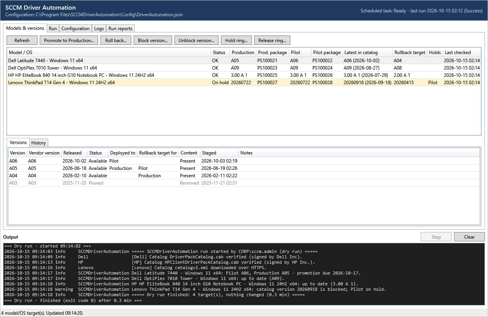

A blocked version (red) and a ring on hold (yellow): the newest Lenovo pack caused a problem in Pilot,
so it was rolled back, blocked and the ring held until a fixed pack is released.

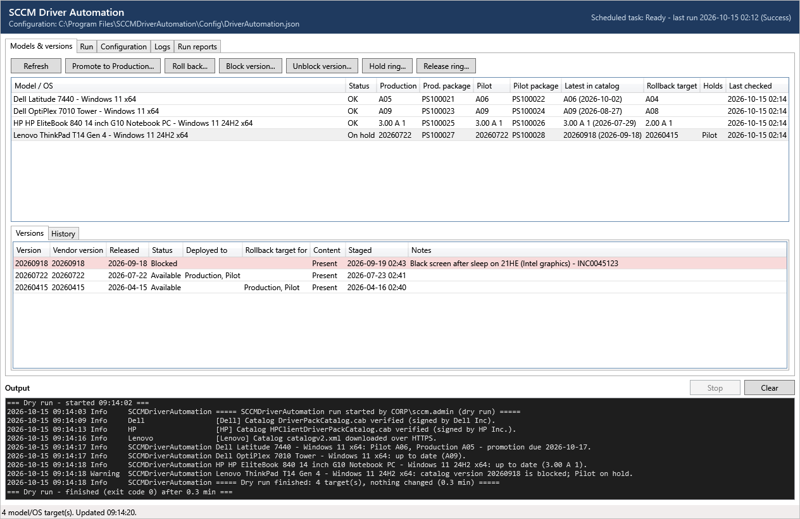

The **History** tab records every stage, deploy, promotion, rollback, block and hold, with who did it
and why.

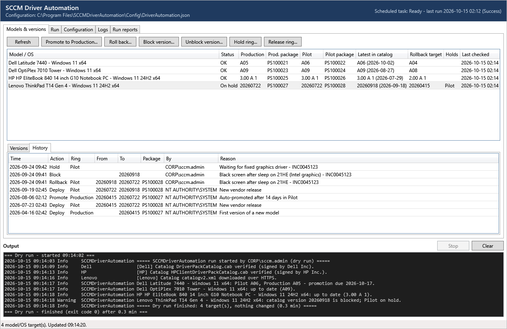

**Roll back...** asks for the ring, the version (list open) and a reason. Promote, block and hold use
the same dialog.

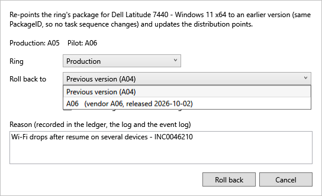

### Run

Preflight, dry run or full run as you, and the state of the SYSTEM scheduled task. Script output
appears in the panel at the bottom of every tab.

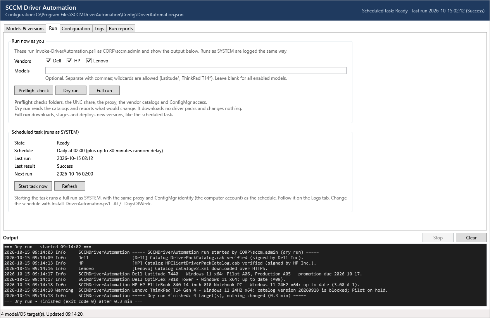

### Configuration

**Models**: the managed models and their operating systems.

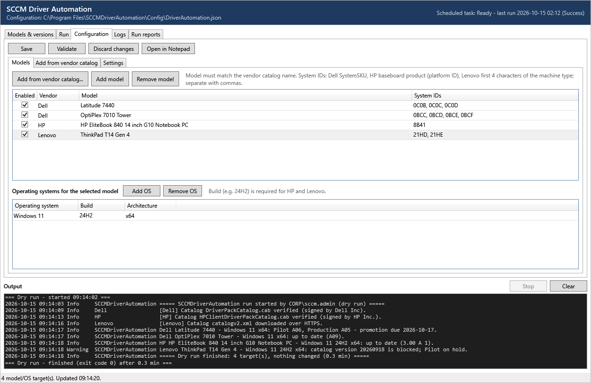

**Add from vendor catalog**: search every model the vendors publish packs for, tick models and builds,
and add them to the configuration.

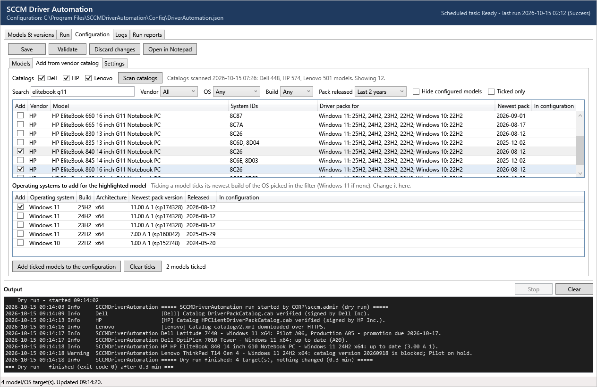

The filters narrow the list by vendor, OS, build (list open) and pack age.

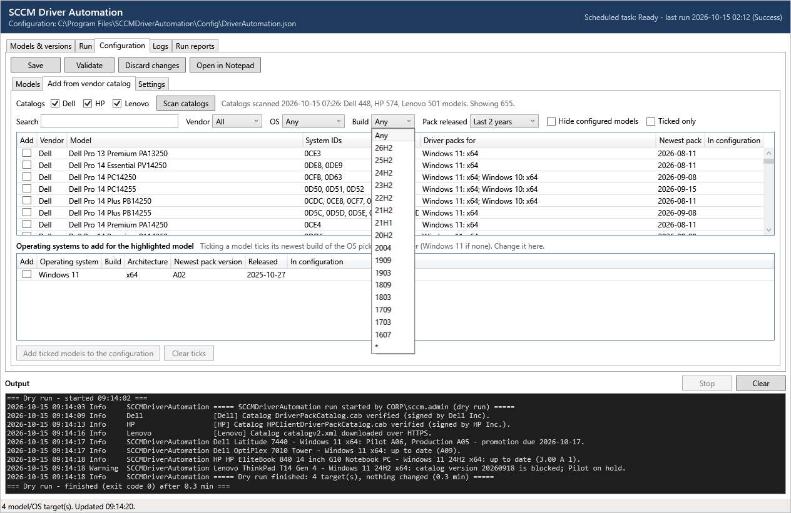

**Settings**: every other setting, with help text, validated before saving.

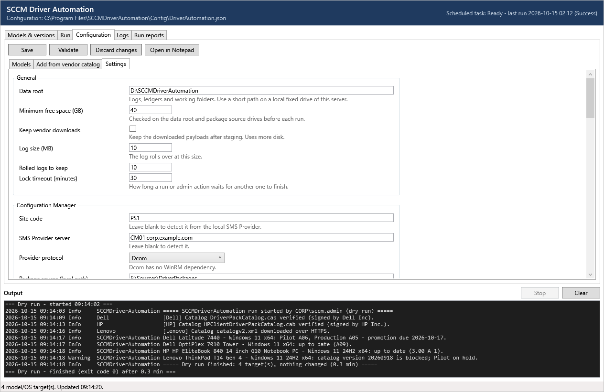

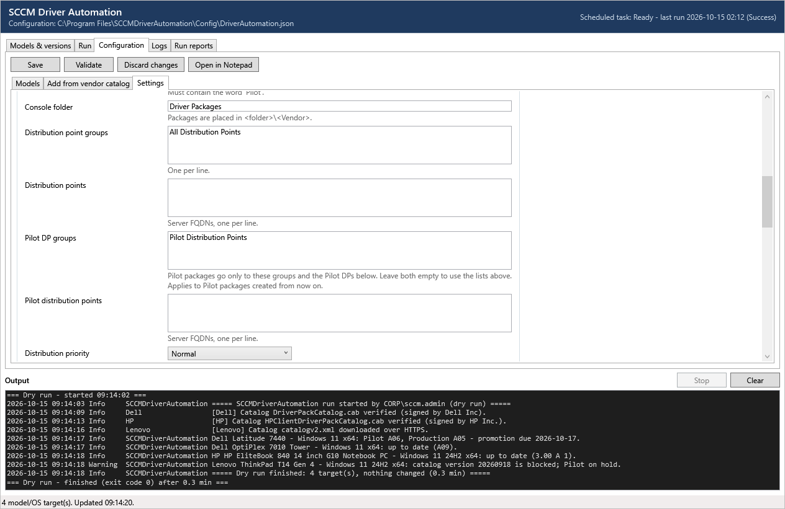

### Logs

The CMTrace logs with filtering, warnings-only and auto-refresh. The file list (open) includes the
catalog-scan log.

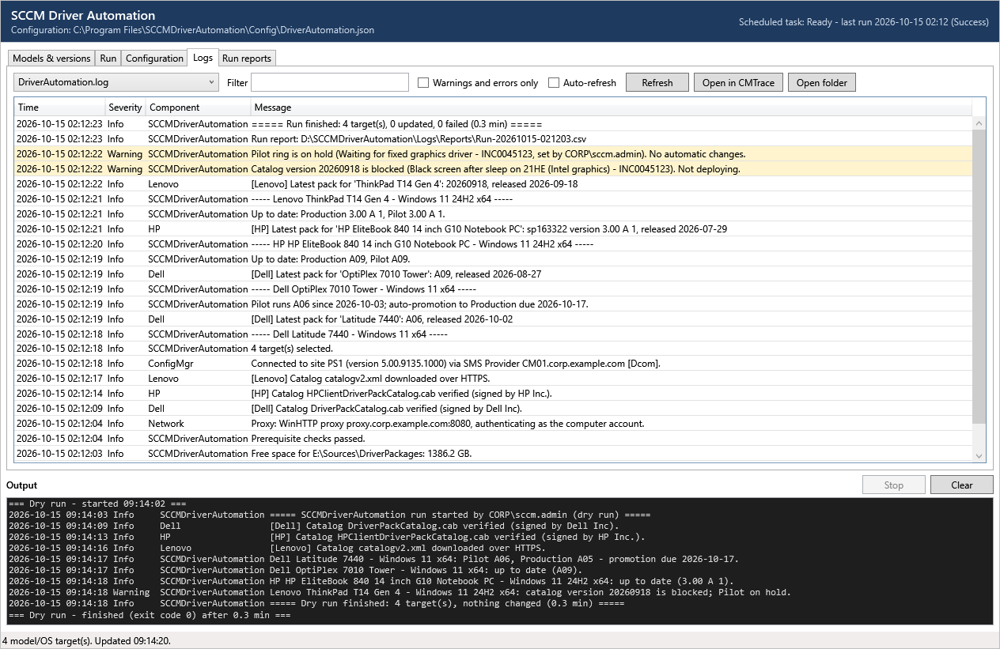

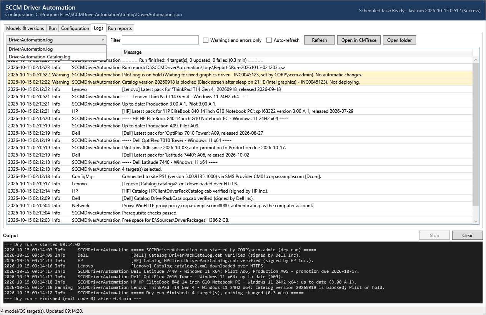

### Run reports

The CSV report of each run, colour-coded by status.

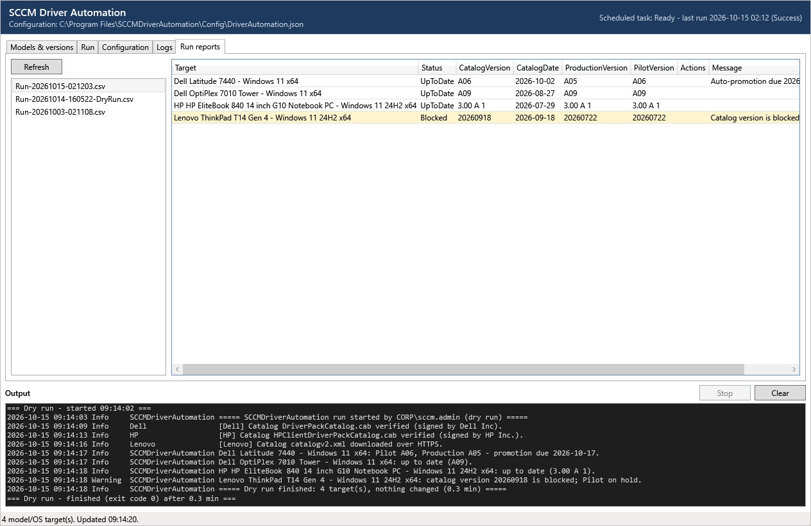

---

## Contents

| File | Purpose |
|---|---|
| `Invoke-DriverAutomation.ps1` | Scheduled entry point (`-DryRun`, `-PreflightOnly`, `-Vendor`, `-Model`) |
| `Invoke-DriverRollback.ps1` | Roll a ring back to the previous or a specific version (`-ListVersions` to inspect) |
| `Invoke-DriverPromotion.ps1` | Promote Pilot (or a specific version) to Production |
| `Set-DriverDeploymentState.ps1` | Block / unblock versions, hold / release rings (ledger only) |
| `Get-DriverVersionReport.ps1` | What is deployed where, rollback targets, history, DP status |
| `Get-DriverCatalogModels.ps1` | Every model and Windows build the vendor catalogs publish packs for, with the exact Model / SystemIds values to configure |
| `Start-DriverAutomationGUI.ps1` | Management GUI: versions and history, promote / roll back / block / hold, runs, configuration editor, log and report viewer |
| `Set-DriverAutomationProxyCredential.ps1` | Store a proxy credential (only if computer-account auth is not possible) |
| `Install-DriverAutomation.ps1` | Install, lock down ACLs, register the event source and the SYSTEM scheduled task, run the preflight |
| `Config\DriverAutomation.json` | All settings and the list of managed models |
| `REQUIREMENTS.md`, `INSTRUCTIONS.md` | Requirements and permissions; installation and operating instructions |
| `images\` | Screenshots used in this README |
| `Modules\SCCMDriverAutomation\` | The module: Logging, Configuration, VersionStore, Network, Catalog, CatalogBrowse, Vendor{Dell,HP,Lenovo}, Staging, ConfigMgr, Deployment, Session |

---

## How it works

```
 Vendor catalog (signed CAB / HTTPS XML)
          │  newest pack for model + OS
          ▼
 Known in ledger? ── yes ──► already deployed / blocked / held?  → nothing to do
          │ no
          ▼
 Download (proxy, resume, retry) → vendor hash + Authenticode → Defender scan
          → extract → INF check → DISM WIM capture → DriverManifest.json
          ▼
 <package source share>\<Vendor>\<Model>\<OS Build Arch>\<VersionId>\   (immutable)
          ▼
 Entry ring package (Pilot if enabled, else Production)
   create once, afterwards only PkgSourcePath is re-pointed + RefreshPkgSource
          ▼
 Optional auto-promotion Pilot → Production after N days, then retention
```

### Versioning model

* **One package per model, OS and ring.** The PackageID never changes. Deploying a version, promoting
  it or rolling it back only changes the package's source path, version field and description, and
  then triggers a DP content update. Task sequences that reference the package directly keep working,
  and so does Modern Driver Management (`Invoke-CMApplyDriverPackage.ps1`).
  * Production package: `Drivers - Dell Latitude 7440 - Windows 11 x64`
  * Pilot package: `Drivers Pilot - Dell Latitude 7440 - Windows 11 x64`. MDM excludes names
    containing *Pilot* in Production mode and uses them in Pilot mode.
* **Disk space.** Both packages point at the same version folders, so each version is stored once on
  the package source share. On the site server and the DPs, ConfigMgr's content library stores
  identical files once, so a Pilot package on the same version as Production adds almost nothing.
  Extra space is used only while a newer version is in Pilot, because the DPs hold both versions.
* **Where Pilot content goes.** By default Pilot packages go to the same DP groups and DPs as
  Production. To keep Pilot content off most DPs, set `ConfigMgr.PilotDistributionPointGroups` and/or
  `PilotDistributionPoints` (**Configuration > Settings > Pilot DP groups** in the GUI). When either is
  set, Pilot packages go only to those. Pilot devices must then be in boundary groups that can reach
  those DPs, or the task sequence can't download the Pilot package. The setting applies when a Pilot
  package is created. For existing Pilot packages, remove them from the other DPs in the console.
* **Version folders are immutable.** They are built in a temporary folder and renamed into place, so
  every retained version is an exact, re-deployable copy. The `DriverManifest.json` inside each folder
  records the source URL, hashes, signer, INF count and who staged it.
* **Ledger.** `<DataRoot>\State\<model-key>.json` holds the PackageID per ring, the deployed version
  per ring, holds, every staged version (Available / Blocked / Pruned), and an append-only history of
  Stage / Deploy / Promote / Rollback / Block / Unblock / Hold / Release / Prune / Adopt entries. Each
  history entry records the initiating identity and the reason. Writes are atomic and keep a `.bak`
  copy. A machine-wide mutex prevents the scheduled run and an administrator's rollback from
  interleaving.
* **Retention.** `RetainVersions` staged versions are kept per target, minimum 2. Versions deployed
  to any ring, and each ring's current rollback target, are never pruned.
* **Vendor re-releases.** If a vendor republishes a pack under the same version label with a different
  payload, the new staging is given a suffix, e.g. `A11-1f2e3d4c`.
* **No automatic downgrades.** If a vendor withdraws a release and the catalog points back at an older
  pack, the run logs a warning instead of downgrading.

### What it downloads

The tool downloads the vendors' **enterprise driver packs**, not the latest individual drivers. Each
run takes the newest pack the catalog lists for a model, OS and build:

| Vendor | Catalog | Packs |
|---|---|---|
| Dell | `downloads.dell.com/catalog/DriverPackCatalog.cab` | Dell Command Deploy driver packs |
| HP | `hpia.hpcloud.hp.com/.../HPClientDriverPackCatalog.cab` | HP Driver Pack SoftPaqs, per platform and Windows build |
| Lenovo | `download.lenovo.com/cdrt/td/catalogv2.xml` | SCCM driver packs, per model and Windows build |

Vendors rebuild these packs every few months, less often for older models, and some models stop
getting new packs. Individual drivers (graphics, Wi-Fi, chipset) and BIOS updates are released more
often, so a pack is usually behind what Dell Command Update, HP Image Assistant or Lenovo System
Update would install. The packs are still the usual choice for OS deployment: the vendor tests them as
a set, they hold plain INF drivers that DISM can inject offline, and they are signed and hashed in the
catalog, which the tool verifies.

Use the packs to give a freshly imaged device working storage, network and base drivers. To keep
drivers current afterwards, use the vendor update tool, Windows Update for Business driver updates or
ConfigMgr third-party updates. Individual drivers and BIOS updates are not in scope for this tool.

---

## Logs, events and exit codes

| Item | Location |
|---|---|
| CMTrace log (rolls at `LogMaxSizeMB`) | `<DataRoot>\Logs\DriverAutomation.log` |
| Per-run CSV report (last 90 kept) | `<DataRoot>\Logs\Reports\Run-yyyyMMdd-HHmmss.csv` |
| DISM capture logs | `<DataRoot>\Logs\dism-*.log` |
| Ledgers | `<DataRoot>\State\*.json` (+ `.bak`) |
| Version provenance | `DriverManifest.json` in every version folder |

Event log: Application, source `SCCMDriverAutomation`.

| Event ID | Meaning |
|---|---|
| 1000 | Run succeeded |
| 1001 | Run finished with failures |
| 1002 | Run failed |
| 1100 | Deploy or promote |
| 1101 | Rollback |
| 1102 | Block, unblock, hold or release |

Exit codes of `Invoke-DriverAutomation.ps1`: `0` success, `1` one or more targets failed, `2` fatal
error (configuration, lock, prerequisites or site connection).

---

## Scope and limitations

* **Standard packages, not driver catalog import.** Like DAT and MDM, drivers are delivered as
  standard packages and applied with DISM, or with *Apply Driver Package* pointed at the package
  content. Importing tens of thousands of INFs into the ConfigMgr driver catalog bloats the site
  database and slows the console; Microsoft and the community moved away from that pattern.
* Vendor driver packs only. BIOS/firmware, HP per-SoftPaq builds and Dell DCU-style "latest drivers"
  builds are not implemented.
* Arm64 is supported where Dell publishes Arm64 packs. The HP and Lenovo catalogs handled here are x64.
* Lenovo's catalog has no version numbers, so the pack date (`yyyyMMdd`) is the version.

## Testing status

Verified on Windows PowerShell 5.1:
* Configuration validation
* Live parsing of the current Dell, HP and Lenovo catalogs, including Dell and HP catalog signature
  verification
* The SystemId / name conflict guard
* Download, resume, retry and the 404 fast-fail
* Domain allow-list, HTTPS upgrade, zip-slip protection and the delete-path guard
* Hash and Authenticode gates
* Ledger persistence and backup recovery
* Rollback candidate selection, block and hold
* Retention
* The full per-target pipeline in `-DryRun`, including Pilot auto-promotion
* Catalog browsing: every Lenovo row and a 450-row sample across all vendors resolve to the same pack
  with the deployment resolvers, apart from a handful of retired builds where two catalog entries list
  the same hardware and the runtime takes the newest of them

**Not yet exercised against a live site:**
* The ConfigMgr writes: package create / re-point / distribute and folder moves
* Multi-GB extraction and DISM capture

Before you rely on rollback, run `-PreflightOnly` and a first real run against a lab site or a single
model, then do one rollback test.
